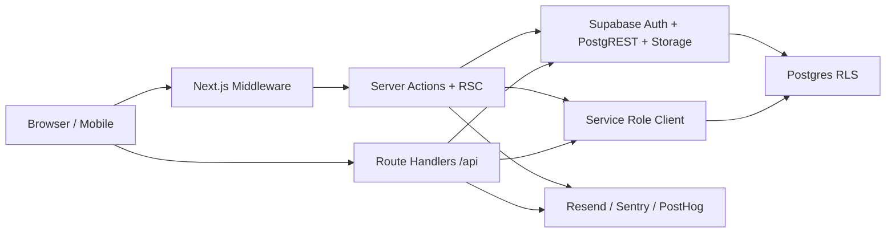

# DentOrd — Threat Model

> STRIDE-oriented threat model for DentOrd Professional MVP (Faze 1–3).
> Emphasis: authentication, authorization, multi-tenancy, financial data, personal/health data, file uploads, platform impersonation, cron/service-role.
> Mitigations cite code/DB controls; guarding tests cite IDs from [Test-Strategy.md](./Test-Strategy.md).
> Residual Faza 4 (Stripe/AI/SMS/portal) noted briefly at the end.

---

## 1. Assets

| Asset | Sensitivity | Examples |
|---|---|---|
| Patient PHI / PII | Critical | Name, DOB, phone, allergies, odontogram, documents, images, consents |
| Financial records | Critical | Invoices, payments, expenses, payment plans, PDF receipts |
| Tenant boundaries | Critical | `clinic_id` isolation across all tables + storage |
| Auth credentials | Critical | Passwords, TOTP secrets, session JWTs, operator PINs |
| Service role / cron secrets | Critical | `SUPABASE_SERVICE_ROLE_KEY`, `CRON_SECRET` |
| Audit trail | High | Who changed what; impersonation; GDPR approve |
| Platform admin power | Critical | Plan/status changes; impersonation |
| Marketing leads | Medium | Contact form PII |
| Branding / clinic settings | Medium | Logo, colors, working hours |

---

## 2. Trust boundaries

| Boundary | Rule |
|---|---|
| Browser → App | Anon key only; no service role; cookies httpOnly for session/operator/impersonation |
| App → Postgres (user JWT) | Must pass RLS; never trust client-supplied `clinic_id` for authorization |
| App → Postgres (service role) | Bypasses RLS — only allowlisted server paths; audit when mutating tenants |
| Cron → API | Shared secret; no session |
| App → third parties | No patient names to PostHog; Sentry tags without PHI |

---

## 3. Actors

| Actor | Capability |
|---|---|
| Anonymous visitor | Marketing, signup, lead form, invite accept with token |
| Clinic owner | Full clinic admin + MFA + GDPR approve |
| Doctor / assistant / reception / accountant | Role-scoped clinic access |
| Shared-desk operator | PIN identity on reception/assistant account |
| Platform admin | Cross-clinic via service role + impersonation |
| Malicious insider (staff) | Valid JWT for own clinic; probes IDOR / privilege escalation |
| External attacker | Credential stuffing, token theft, API abuse |
| Compromised dependency / CI | Secret exfiltration |

---

## 4. Threat catalog (STRIDE)

Each row: **Threat ID**, category, description, likelihood×impact → **Risk**, mitigations, **Test IDs**.

### 4.1 Authentication (AUTH)

| ID | STRIDE | Threat | Risk | Mitigations | Tests |
|---|---|---|---|---|---|
| T-AUTH-01 | Spoofing | Credential stuffing / brute force login | High | Lockout after 5 fails; `check_login_lockout` | `AUTH-DB-001`, `AUTH-INT-002` |
| T-AUTH-02 | Spoofing | Owner skips MFA / uses aal1 session for writes | Critical | MW MFA gate + RLS `owner_mfa_ok` | `AUTH-E2E-003`, `AUTH-RLS-001` |
| T-AUTH-03 | Spoofing | Stolen invite token accepted twice / expired | High | Token hash; status transitions; expiry | `AUTH-SEC-001`, `AUTH-INT-010` |
| T-AUTH-04 | Spoofing | PIN brute force on shared desk | High | 5 fails → 15 min lock; bcrypt | `AUTH-RLS-010`, `AUTH-SEC-002` |
| T-AUTH-05 | Tampering | Session fixation / long-lived session after deactivate | High | `is_active` checks; force logout; JWT hook skips inactive | `AUTH-INT-020` (COVERED), `AUTH-INT-021` |
| T-AUTH-06 | Elevation | Self-promote `role` to owner via profiles UPDATE | Critical | Trigger + RLS | `AUTH-RLS-002` (COVERED) |
| T-AUTH-07 | Info disclosure | Lockout RPC leaks whether email exists | Medium | Generic errors; review RPC messages | `AUTH-SEC-003` |
| T-AUTH-08 | Spoofing | Platform admin flag set via `user_metadata` | Critical | Code only trusts `app_metadata` | `PLAT-UNIT-001`, `PLAT-SEC-001` |

### 4.2 Authorization / RBAC

| ID | STRIDE | Threat | Risk | Mitigations | Tests |
|---|---|---|---|---|---|
| T-RBAC-01 | Elevation | Doctor calls invoice/expense writes via PostgREST | Critical | RLS `can_write_invoices` | `RBAC-RLS-001` (COVERED) |
| T-RBAC-02 | Elevation | Accountant writes patients / odontogram | High | RLS clinical helpers | `RBAC-RLS-002` (COVERED) |
| T-RBAC-03 | Elevation | Doctor mutates another doctor’s appointments | High | RLS + SA doctor scope | `RBAC-INT-005`, `CAL-INT-004` (COVERED P3.2) |
| T-RBAC-04 | Elevation | Non-owner reads audit_events | High | Owner-only SELECT RLS | `RBAC-RLS-005` (COVERED) |
| T-RBAC-05 | Elevation | Non-owner approves GDPR erasure | Critical | RPC owner+MFA | `PII-RLS-001` (COVERED) |
| T-RBAC-06 | Elevation | Feature used without entitlement (Starter on CRM/inventory) | High | SA `assertFeature` only — **DB gap** | `PLAN-INT-011`, `PLAN-SEC-001` |
| T-RBAC-07 | Elevation | Server Action forgotten RBAC (defense gap) | High | Mirror checks + RLS backstop | `RBAC-INT-001..004/006..010/012..017/021` (COVERED P3.1); `005` → P3.2 |

### 4.3 Multi-tenancy

| ID | STRIDE | Threat | Risk | Mitigations | Tests |
|---|---|---|---|---|---|
| T-TEN-01 | Info disclosure | Clinic A SELECT Clinic B patients/appts/profiles | Critical | RLS `clinic_id = current_clinic_id()` | `TEN-RLS-001..009` (PARTIAL COVERED) |
| T-TEN-02 | Tampering | Clinic A UPDATE/INSERT with forged foreign `clinic_id` | Critical | RLS WITH CHECK | `TEN-RLS-010`, `TEN-SEC-002` |
| T-TEN-03 | Info disclosure | Cross-clinic IDOR via known UUID in URL | Critical | RLS + RSC not-found | `TEN-E2E-001` (COVERED) |
| T-TEN-04 | Info disclosure | Cross-clinic storage list/download | Critical | Storage folder RLS | `FILE-RLS-001` (PARTIAL) |
| T-TEN-05 | Elevation | Move profile to another clinic | Critical | Trigger blocks clinic_id change | `AUTH-RLS-002` |
| T-TEN-06 | Spoofing | Stale JWT `app_metadata.app_role` after role change | High | Role helpers profiles-first (`TEN-SEC-003`); re-login refreshes claims | `TEN-SEC-003` |
| T-TEN-07 | Tampering | JWT hook disabled → rely on fallback only | Medium | Ops enable hook; both paths tested | `TEN-SEC-004` |
| T-TEN-08 | Elevation | Cross-clinic membership (future D51) accidentally shipped | Medium | Negative test no switcher | `TEN-SEC-001` |

### 4.4 Financial data

| ID | STRIDE | Threat | Risk | Mitigations | Tests |
|---|---|---|---|---|---|
| T-FIN-01 | Tampering | Duplicate / skip invoice numbers | High | `allocate_invoice_number` row lock | `FIN-DB-001`, `FIN-INT-001` |
| T-FIN-02 | Tampering | Allocate number for another clinic_id | Critical | RPC checks `current_clinic_id` | `FIN-SEC-001` |
| T-FIN-03 | Tampering | DELETE payment or rewrite invoice line | Critical | Append-only policies | `FIN-RLS-001` |
| T-FIN-04 | Tampering | Mark paid without payment rows | High | Trigger recompute status | `FIN-DB-002` |
| T-FIN-05 | Info disclosure | Doctor sees peer revenue when setting off | High | `dashboard_payment_stats` | `FIN-INT-020` |
| T-FIN-06 | Info disclosure | PDF download IDOR across clinics | Critical | API clinic scope + storage path | `FIN-API-001`, `FILE-SEC-003` |
| T-FIN-07 | Tampering | Void then mutate historical PDF | Medium | Immutable stored PDF | `FIN-INT-002` |
| T-FIN-08 | Elevation | Non-finance role Excel export | High | API `canAccessExpenses` + feature | `FIN-API-002` |

### 4.5 Personal / health data (PII/PHI)

| ID | STRIDE | Threat | Risk | Mitigations | Tests |
|---|---|---|---|---|---|
| T-PII-01 | Tampering | GDPR hard delete without owner approval | Critical | Request queue + owner RPC MFA | `PII-RLS-001` |
| T-PII-02 | Tampering | Partial erase leaves docs/images/consents | Critical | RPC deletes subtree + storage | `PII-INT-001`, `FILE-INT-020` |
| T-PII-03 | Info disclosure | Patient names in PostHog/Sentry | High | Analytics helpers; Sentry scrub | `PII-SEC-001` |
| T-PII-04 | Info disclosure | Export API without RBAC | Critical | API guards | `PII-API-001`, `PII-API-002` |
| T-PII-05 | Info disclosure | Audit payload contains excess PHI in exports | Medium | Audit review guidelines | `PII-SEC-004` |
| T-PII-06 | Repudiation | Missing audit on GDPR / invite / settings | High | writeAuditEvent paths | `PII-INT-002`, `RBAC-INT-001` |
| T-PII-07 | Info disclosure | Lead table readable by authenticated users | High | RLS deny-all + REVOKE | `MKT-SEC-001` |

### 4.6 File uploads & storage

| ID | STRIDE | Threat | Risk | Mitigations | Tests |
|---|---|---|---|---|---|
| T-FILE-01 | Tampering | Upload outside `{clinic_id}/` prefix | Critical | Storage RLS folder check | `FILE-RLS-002` |
| T-FILE-02 | Info disclosure | Public bucket / long-lived public URL | Critical | Private buckets; signed TTL | `FILE-SEC-001` |
| T-FILE-03 | Tampering | Exceed image limit via direct INSERT/storage | High | **App-only limit** — residual risk | `FILE-DB-001`, `PLAN-INT-002` |
| T-FILE-04 | Tampering | Malicious file (polyglot, oversized) | Medium | Type/size checks; WebP convert | `FILE-INT-001` |
| T-FILE-05 | Info disclosure | Signed URL leaked / too long TTL | Medium | Short TTL (120s files; 3600s logo) | `FILE-SEC-004` |
| T-FILE-06 | Elevation | Non-writer uploads branding logo | High | Storage + SA owner | `FILE-INT-011` |

### 4.7 Platform admin & service role

| ID | STRIDE | Threat | Risk | Mitigations | Tests |
|---|---|---|---|---|---|
| T-PLAT-01 | Elevation | Impersonation without audit | Critical | SA writes audit start/stop | `PLAT-INT-001` |
| T-PLAT-02 | Elevation | Sticky impersonation cookie after stop | High | MW clears mismatch | `PLAT-SEC-002` |
| T-PLAT-03 | Info disclosure | Service role key in client bundle | Critical | Never import `createServiceClient` in client | `PLAT-SEC-003` |
| T-PLAT-04 | Elevation | Cron lifecycle without secret | Critical | Bearer/`?secret=` check | `LIFE-API-001` |
| T-PLAT-05 | Tampering | Hard-delete demo clinic | High | `is_demo` guard | `LIFE-SEC-002` |
| T-PLAT-06 | Elevation | Clinic status/plan change by non-admin | Critical | MW + `isPlatformAdmin` | `PLAT-INT-002` |

### 4.8 Availability / abuse

| ID | STRIDE | Threat | Risk | Mitigations | Tests |
|---|---|---|---|---|---|
| T-AVL-01 | DoS | Lead form spam | Medium | Honeypot + IP rate limit | `MKT-INT-001`, `MKT-SEC-002` |
| T-AVL-02 | DoS | CSV import huge file | Medium | Max 500 rows / 1 MB | `IMP-INT-002` |
| T-AVL-03 | DoS | Overlap storms / calendar write flood | Low | DB EXCLUDE; auth required | `CAL-DB-001` |

---

## 5. Abuse-case narratives (priority for Critical tests)

### AC1 — Cross-tenant data theft
Attacker with Clinic A doctor JWT enumerates UUIDs / filters `clinic_id=B` on patients, invoices, storage.  
**Must fail** at RLS. Release blocker.

### AC2 — Privilege escalation to owner
Doctor PATCHes `profiles.role='owner'` or inserts owner invite for self.  
**Must fail** at trigger/RLS/limits.

### AC3 — Owner MFA downgrade
Owner completes login at aal1 and POSTs clinical/finance mutations.  
**Must fail** at RLS restrictive policies (and MW for UI).

### AC4 — Silent GDPR wipe
Reception calls approve RPC or deletes patient rows directly.  
**Must fail** unless owner+MFA approve path.

### AC5 — Financial forgery
Accountant from Clinic A calls `allocate_invoice_number(B)` or deletes payments.  
**Must fail**.

### AC6 — Service-role / cron compromise
Attacker hits `/api/cron/clinic-lifecycle` without secret → mass pending_delete/hard delete.  
**Must fail** auth on route.

### AC7 — Impersonation without trace
Platform admin (or stolen admin session) switches to clinic owner without audit row.  
**Must create** `platform.impersonation_*` events.

### AC8 — Entitlement bypass
Starter clinic (or forged plan) inserts `crm_notifications` / `inventory_items` via PostgREST despite feature off.  
**Today may succeed at DB** — treat as Critical residual until DB gate or documented acceptance of app-only gate + monitoring.

---

## 6. Residual risks (accepted or deferred)

| Risk | Status | Plan |
|---|---|---|
| Feature entitlements app-only | Accepted short-term with SEC tests documenting bypass | P1 add DB checks for highest-risk features or keep as known residual with monitoring |
| Image limit app-only | Same | P1 `FILE-DB-001` + optional trigger |
| Phase 1 schema not in local migrations | Blocks hermetic tests | **P0** dump schema |
| JWT hook manually enabled | Ops | Production-Ops + `TEN-SEC-004` |
| Stripe / metered / portal (2027) | Out of MVP | Threat model addendum in Faza 4 |
| External pen-test | Recommended before mass billing | Open item PRD §14 |
| Email notification on lockout | Deferred §6.16 | MVP notify = audit (`AUTH-INT-002` COVERED); push email/bell when notification center ships |

---

## 7. Security test mapping summary

| Priority threats | Primary suites |
|---|---|
| T-TEN-*, T-FILE-01/02, T-AUTH-02/06, T-FIN-02/03/06, T-PII-01/02, T-PLAT-03/04 | Vitest security + RLS (P1) |
| T-RBAC-*, T-FIN-01/05, T-FILE-03 | INT + DB (P1–P3) |
| Journeys J1–J7 | Playwright (P4) |
| Abuse leads / CSV | INT (P5) |

Full per-test fields: [Test-Strategy.md](./Test-Strategy.md).  
Code vs PRD gaps that create threats: [Discrepancies.md](./Discrepancies.md).

---

*Threat model — DentOrd QA — 2026-07-23.*
